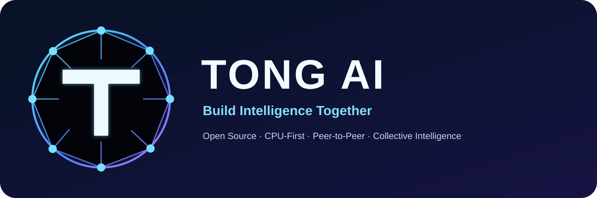
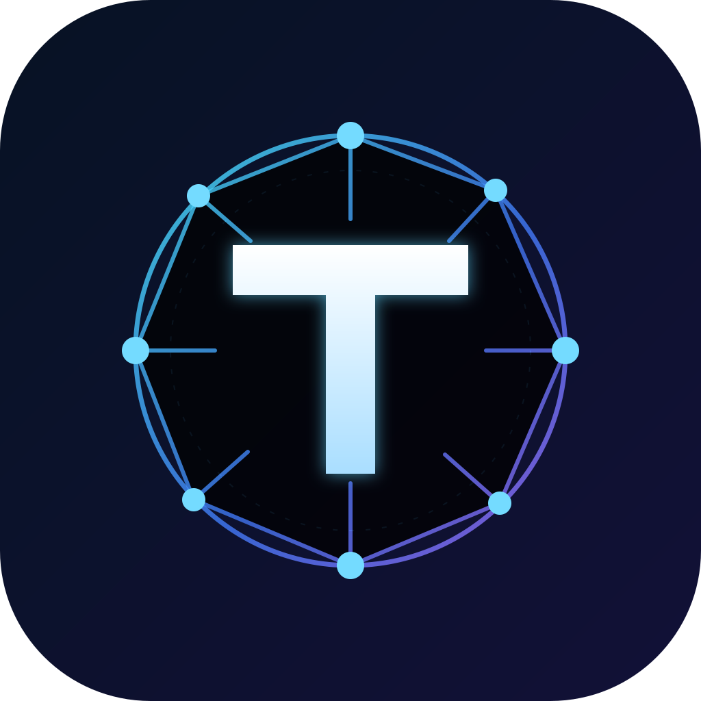

<p align="center">
  
</p>

<p align="center">
  <strong>One evolving network. Many independent nodes. Intelligence for everyone.</strong>
</p>

<p align="center">
  <a href="https://github.com/parmtech/tong-ai"></a>
  <a href="https://github.com/parmtech/tong-ai/issues"></a>
  <a href="https://github.com/parmtech/tong-ai/discussions"></a>
  
</p>

---

## 🌐 Welcome to TONG AI

**TONG AI** is an open-source research initiative exploring **decentralized collective intelligence**: a network of devices and AI specialists that share permitted computational work, validated learning and useful knowledge.

Our goal is to investigate **faster responses, lower energy consumption, hardware portability and continuous improvement**, using CPU-first technology, peer-to-peer networking and community participation.

> **Honest project status:** TONG AI is at an early research stage. A working global AI network, a self-evolving foundation model, guaranteed three-second responses and a registered nonprofit foundation do **not** yet exist. "Collective consciousness" describes distributed coordination, not proven machine sentience.

## ✨ What makes TONG AI different?

| Principle | What it means |
| --- | --- |
| 🧠 **Collective Intelligence** | Many nodes coordinate as one logical research system, without a single indispensable central brain. |
| ⚡ **Efficient by Design** | CPU-first workloads, intelligent routing and selective computation; real savings must be demonstrated by benchmarks. |
| 🌍 **Decentralized Network** | Independent owner-controlled devices can provide eligible compute, memory or validation capacity. |
| 📚 **Continuous Learning Research** | Explore consent-based feedback and validated learning, while avoiding unsafe or unverified model updates. |
| 🧩 **Modular & Future-Ready** | Hardware adapters for CPUs, GPUs, NPUs and future accelerators, including experimental quantum integrations. |
| 🌱 **Public Benefit & Privacy** | Transparency, responsible resource consumption, data minimisation and informed user participation. |

## 🧬 How the collective network is designed to work

```text
                    USER / CHAT / DEVELOPER API
                               |
                     REQUEST CLASSIFICATION
                               |
                      COLLECTIVE ROUTER
                               |
             +-----------------+-----------------+
             |                 |                 |
        FAST INFERENCE    COMMUNITY TASKS    MEMORY / SKILLS
        dedicated nodes     eligible peers     relevant nodes
             |                 |                 |
             +-----------------+-----------------+
                               |
                      VALIDATE & ASSEMBLE
                               |
                        STREAM THE ANSWER
                               |
               OPT-IN FEEDBACK / SAFE LEARNING
```

The router should select the **best eligible node**, based on actual capability, available memory, latency, model readiness, consent and the device owner's limits. Splitting one model across distant phones is not automatically faster.

## 🏆 Three-tier access — one collective network

| Tier | Priority | Resource allocation |
| --- | --- | --- |
| 🥇 **Paid** | **1 — Highest** | Proposed foundation-owned or leased high-performance servers with fast networking, first scheduling priority and the most capable available models. |
| 🥈 **Contributor Credits** | **2 — Community** | Verified contributors earn non-transferable service credits to access greater shared capacity. |
| 🥉 **Free** | **3 — Accessible** | Lower-priority shared resources, with fair limits and offline features where supported. |

The network and core research remain shared. Different access tiers determine **compute resources, usage and priority**; they do not create independent collective minds.

## 🛠️ Project roadmap

- **M0 — Foundation:** public repository, specification, governance, FAQ and contributor onboarding.
- **M1 — Two CPU Nodes:** authenticated communication, task routing, consent limits and realistic latency tests.
- **M2 — Collective Scheduling:** heterogeneous nodes, verified task receipts and experimental credit balances.
- **M3 — Learning Research:** isolated small-model learning, independent evaluation and rollback.
- **M4 — Community Clients:** Android node, chat interface, usable SDK and transparency metrics.
- **M5 — Sustainable Infrastructure:** evaluate nonprofit formation, open financial reporting, dedicated capacity and high-availability deployment.

Each milestone must publish evidence, not just claims.

## 📚 Essential documentation

| Resource | Link |
| --- | --- |
| **A–Z Blueprint** | [Read the architecture and research plan](https://github.com/parmtech/tong-ai/blob/main/docs/BLUEPRINT_A_TO_Z.md) |
| **1,000 Technical Q&A** | [Explore the FAQ](https://github.com/parmtech/tong-ai/blob/main/docs/faq/FAQ_1000.md) |
| **Live Handoff** | [Current project status and next actions](https://github.com/parmtech/tong-ai/blob/main/docs/handoff/HANDOFF.md) |
| **Contribution Guide** | [How to contribute](https://github.com/parmtech/tong-ai/blob/main/CONTRIBUTING.md) |
| **Roadmap** | [Milestones and priorities](https://github.com/parmtech/tong-ai/blob/main/ROADMAP.md) |
| **Community Discussions** | [Questions, ideas and proposals](https://github.com/parmtech/tong-ai/discussions) |
| **M0 Kickoff Issue** | [Track the initial GitHub import](https://github.com/parmtech/tong-ai/issues/1) |

## 🤝 Join the community

We welcome researchers, developers, systems engineers, students, security reviewers, accessibility specialists and people passionate about low-cost AI.

1. **Explore** the blueprint and FAQ.
2. **Discuss** ideas in [GitHub Discussions](https://github.com/parmtech/tong-ai/discussions).
3. **Report** reproducible issues and benchmark evidence.
4. **Contribute** through pull requests, with tests, documented changes and an updated handoff.

Node participation must be voluntary. **Private user conversations are not automatically broadcast or used to train the network.** Learning from user interactions requires explicit consent and suitable privacy protections.

---

<p align="center">
  
</p>
<p align="center"><strong>TONG AI — Build Intelligence Together.</strong></p>
<p align="center"><em>Research · Build · Contribute · Learn · Improve</em></p>
